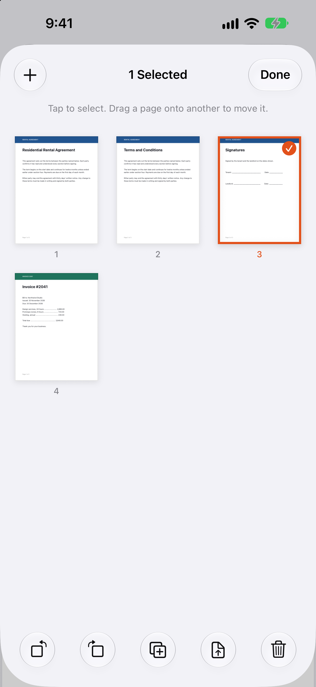
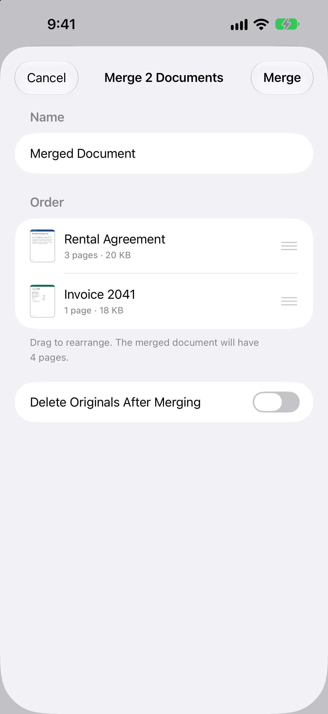
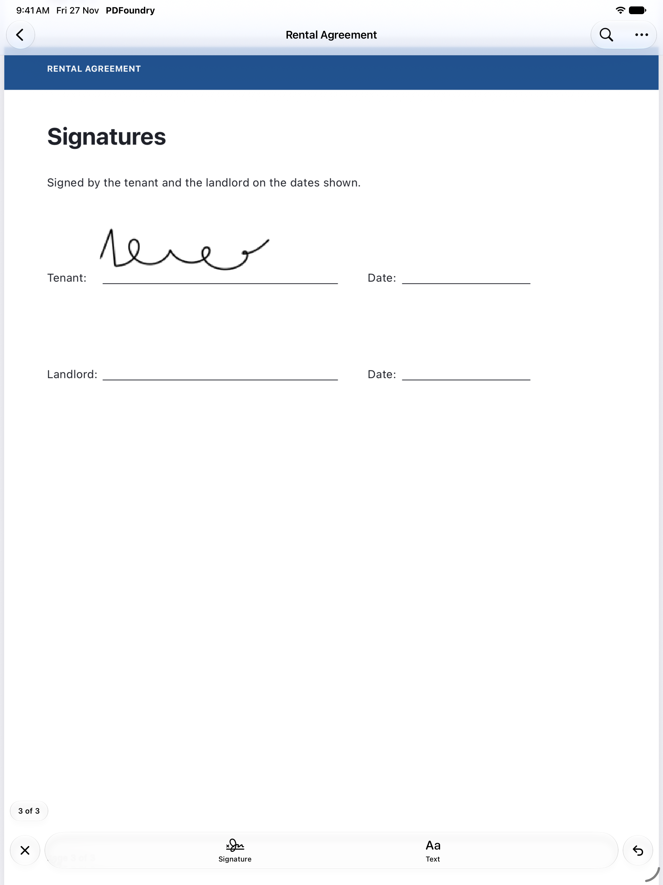
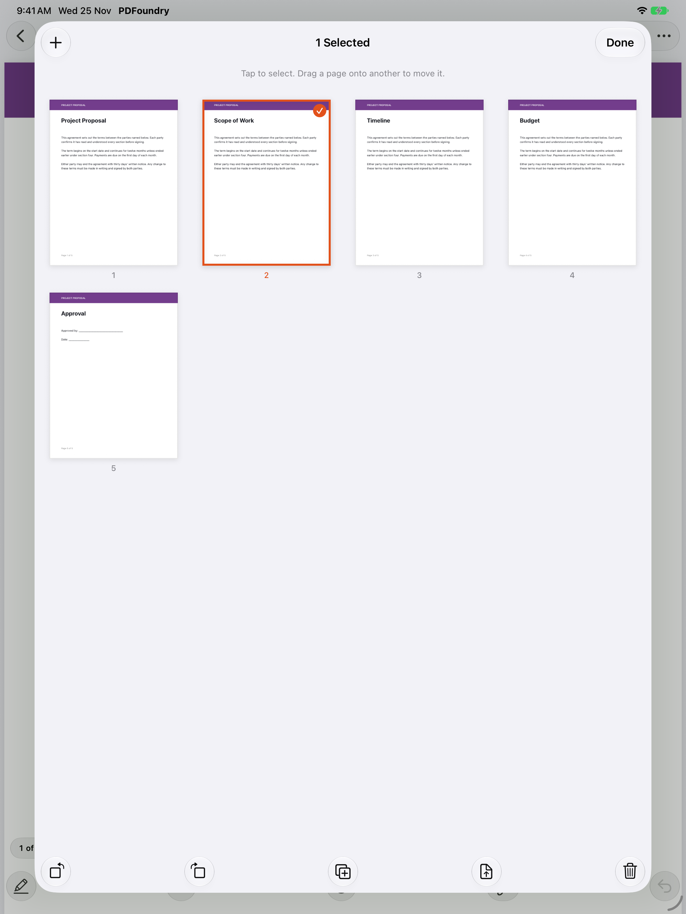
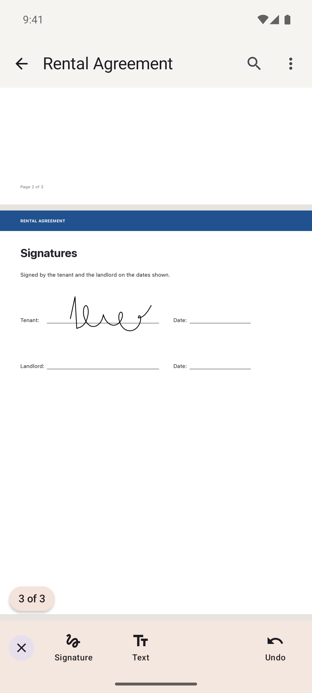
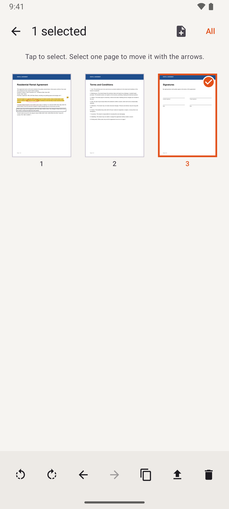
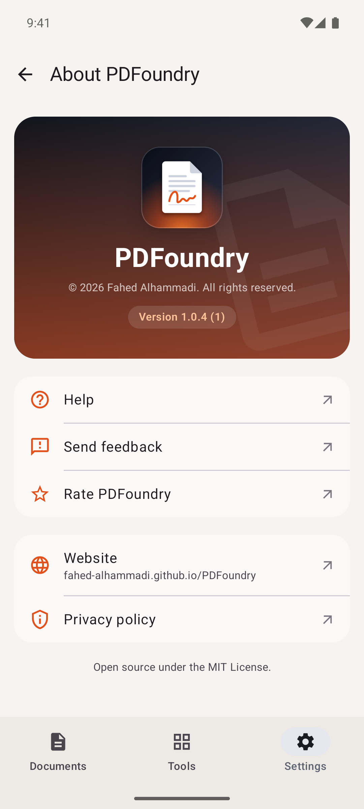

<div align="center">


# PDFoundry

**Read, merge, edit and sign PDFs. Private, on your device, with no account.**

Native apps for iPhone, iPad and Android.

[](https://github.com/Fahed-Alhammadi/PDFoundry/actions/workflows/ios.yml)
[](https://github.com/Fahed-Alhammadi/PDFoundry/actions/workflows/android.yml)
[](LICENSE)


[Website](https://fahed-alhammadi.github.io/PDFoundry/) · [Privacy policy](https://fahed-alhammadi.github.io/PDFoundry/privacy.html) · [Report a problem](https://github.com/Fahed-Alhammadi/PDFoundry/issues)

<br>





</div>

## Contents

- [Overview](#overview)
- [Status](#status)
- [Features](#features)
- [Screenshots](#screenshots)
- [Tech stack](#tech-stack)
- [Getting started](#getting-started)
- [Usage](#usage)
- [Tests](#tests)
- [Configuration](#configuration)
- [Releases](#releases)
- [Project structure](#project-structure)
- [Privacy](#privacy)
- [Contributing](#contributing)
- [License](#license)

## Overview

PDFoundry is a small PDF app that does four jobs well: reading, merging, editing and signing. It works entirely on the device. There is no account, no server, no advertising and no analytics, and the apps make no network requests.

Both apps are native: Swift and SwiftUI on iPhone and iPad, Kotlin and Jetpack Compose on Android.

## Status

| Platform | Version | Status |
|---|---|---|
| iPhone and iPad | 1.0.0 | Submitted to the App Store, waiting for review. Available to testers on TestFlight |
| Android | 1.0.0 | In closed testing on Google Play |

Store links will be added here and on the [website](https://fahed-alhammadi.github.io/PDFoundry/) when the apps are public.

## Features

| | iPhone and iPad | Android |
|---|---|---|
| **Read** | Open from Files, Mail, Safari or the share sheet. Search the text. Scroll vertically or sideways | Open from any app's share menu or file picker. Search the text. Pinch to zoom |
| **Scan and create** | Scan paper with the camera. Build a PDF from photos | Scan paper with Google's document scanner. Build a PDF from photos |
| **Merge** | Select documents, drag them into order, merge | Select documents, order them with arrows, merge |
| **Highlight** | Select text, then highlight (four colours), underline or strike through | Drag a marker over the page |
| **Text and drawing** | Type anywhere. Draw with a finger or Apple Pencil | Type anywhere (Arabic shapes correctly). Draw with a finger or stylus |
| **Sign** | Draw once in black or blue ink, reuse, drag and resize before placing | Same |
| **Pages** | Reorder by dragging. Rotate, duplicate, extract, delete, add blank pages | Reorder with arrows. Rotate, duplicate, extract, delete, add blank pages |
| **Undo** | Tap any mark to remove it, or undo recent edits | Undo the last ten changes while the document is open |
| **Manage** | Rename, duplicate, share, print, delete | Rename, duplicate, share, print, delete |
| **Storage** | The app's folder in Files, easy to back up | Inside the app. Share a copy to send it elsewhere |
| **Protected PDFs** | Open with the password, read-only | Open with the password, read-only |
| **Permissions** | Camera, asked only when you tap Scan Document | None |

Signatures and edits are written into the PDF itself, so they look the same in every other PDF reader. Password-protected documents open read-only so their protection is never removed.

## Screenshots

**iPad**

<p>
  
  
  
</p>

**Android**

<p>
  
  
  
  
</p>

## Tech stack

| | iPhone and iPad | Android |
|---|---|---|
| Language | Swift 6, strict concurrency, main-actor default isolation | Kotlin |
| UI | SwiftUI with Liquid Glass | Jetpack Compose, Material 3 |
| PDF engine | PDFKit | [PdfBox-Android](https://github.com/TomRoush/PdfBox-Android) for editing, the platform `PdfRenderer` for display |
| Drawing | PencilKit | Compose canvas |
| Scanning | VisionKit document camera | ML Kit document scanner |
| Minimum OS | iOS 26.0 | Android 8.0 (API 26) |
| Project | [XcodeGen](https://github.com/yonaskolb/XcodeGen) (`project.yml`) | Gradle (Kotlin DSL) |
| Tests | Swift Testing | Instrumented JUnit tests |

The iOS app has no third-party dependencies.

## Getting started

```bash
git clone https://github.com/Fahed-Alhammadi/PDFoundry.git
cd PDFoundry
```

### iPhone and iPad

Requires Xcode 27 or later and XcodeGen (`brew install xcodegen`).

```bash
xcodegen generate
open PDFoundry.xcodeproj
```

Select the **PDFoundry** scheme and run. To run on a device, set your own team under *Signing & Capabilities*, or `DEVELOPMENT_TEAM` in `project.yml`.

### Android

Requires JDK 21 and the Android SDK. Open the `android/` folder in Android Studio, or build from the command line:

```bash
cd android
./gradlew :app:assembleDebug
```

The debug build installs next to a Play Store copy, under the ID `io.pdfoundry.app.debug`. See [android/README.md](android/README.md) for release signing.

## Usage

| To | iPhone and iPad | Android |
|---|---|---|
| Add a document | **+** in the library: Import from Files, Scan Document, or Create from Photos | **+** in the library: Import PDF, Scan document, or Create from photos |
| Merge | **Select**, choose documents, tap the merge button | Press and hold to select, choose documents, tap the merge button |
| Highlight | Press and hold text to select it, then tap the highlighter | Tap **Highlight**, then drag over the page |
| Add text | Tap **Aa**, type, drag the text into place, tap **Place** | Tap **Text**, type, drag the text into place, tap **Place** |
| Draw | Tap the pencil, draw, tap **Done** | Tap **Draw**, draw, tap **Done** |
| Sign | Tap the signature button, draw or pick a signature, position it, tap **Place** | Tap **Sign**, draw or pick a signature, position it, tap **Place** |
| Edit pages | **…** then **Organize Pages** | **⋮** then **Organize pages** |
| Remove an edit | Tap it, then **Delete** | Tap **Undo** |

## Tests

```bash
# iOS: unit tests on a simulator
xcodebuild test -project PDFoundry.xcodeproj -scheme PDFoundry \
  -destination 'platform=iOS Simulator,name=iPhone 18 Pro'

# Android: PDF engine tests on a running emulator or device
cd android && ./gradlew :app:connectedDebugAndroidTest
```

Both suites run in GitHub Actions on every push.

## Configuration

The apps need no API keys, servers or environment variables to build and run.

## Releases

| Platform | Trigger | Result |
|---|---|---|
| iOS | Push a tag `ios-X.Y.Z`, or run the **iOS** workflow with "upload" ticked | Signed archive uploaded to TestFlight, internal and external testers |
| Android | Push a tag `android-X.Y.Z`, or run the **Android** workflow with "upload" ticked | Signed bundle uploaded to Google Play closed testing |

Release notes come from `AppStore/whatsnew/en-US.txt` and `android/whatsnew/whatsnew-en-US`. Promotion to the public stores is done by hand.

## Project structure

```
PDFoundry/
├── project.yml                 # XcodeGen project definition (iOS)
├── PDFoundry/                  # iOS app
│   ├── App/                    # Entry point and tab layout
│   ├── Core/                   # Library store, PDF operations, signature store, brand
│   ├── Features/
│   │   ├── Library/            # Document grid, import, scan, merge
│   │   ├── Reader/             # PDF view, markup, drawing, placement
│   │   ├── Pages/              # Page organizer
│   │   ├── Sign/               # Signature pad and saved signatures
│   │   └── Settings/           # Settings and About
│   └── Resources/              # Asset catalog, privacy manifest
├── PDFoundryTests/             # iOS unit tests
├── android/                    # Android app
│   ├── app/src/main/           # Kotlin sources: data/ (PDF engine, library), ui/ (screens)
│   ├── app/src/androidTest/    # PDF engine tests
│   ├── play/                   # Google Play listing text and store images
│   └── whatsnew/               # Google Play release notes
├── AppStore/                   # App Store listing text, store images, release notes
├── Tools/                      # Scripts that render the icons and store images
├── scripts/                    # CI helper for TestFlight
├── Website/                    # Project website (GitHub Pages)
├── screenshots/                # Screenshots by platform
└── .github/workflows/          # iOS, Android and website workflows
```

## Privacy

PDFoundry collects nothing. Documents and signatures stay on the device, and the apps contain no analytics or advertising. The Android build removes the network permission altogether, so it cannot reach the internet. Read the [privacy policy](https://fahed-alhammadi.github.io/PDFoundry/privacy.html).

## Contributing

Issues and pull requests are welcome.

1. Open an issue first for anything larger than a small fix, so the approach can be agreed.
2. Keep each pull request focused on one change.
3. Run the tests for the platform you touched before opening it.

## License

Released under the [MIT License](LICENSE).

© 2026 Fahed Alhammadi. All rights reserved.
