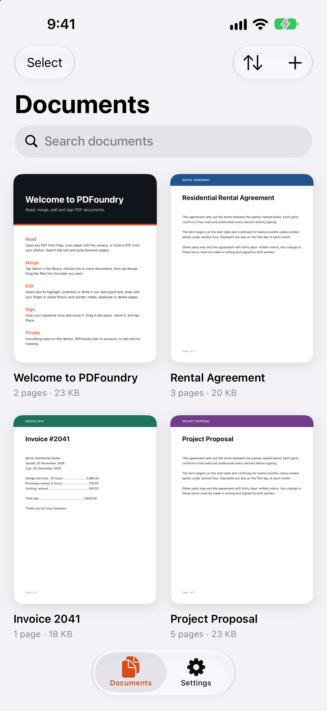

# PDFoundry

Read, merge, edit and sign PDF documents on iPhone and iPad. Everything happens on the device: no account, no ads, no tracking.

**Website:** https://fahed-alhammadi.github.io/PDFoundry/

<p>
  
  
  
  
</p>

## Features

**Read**
- Open PDFs from Files, Mail, Safari or the share sheet
- Scan paper with the camera, or build a PDF from photos
- Search inside a document, scroll vertically or sideways
- Open password-protected PDFs (read-only, so their protection is never removed)

**Merge**
- Select two or more documents, drag them into order, and merge them into one
- Optionally delete the originals afterwards

**Edit**
- Highlight (four colours), underline and strike through selected text
- Add typed text and freehand drawings (finger or Apple Pencil, with the system tool picker)
- Reorder, rotate, duplicate, extract, add and delete pages
- Tap any annotation to remove it; undo your recent edits

**Sign**
- Draw a signature once, in black or blue ink, and reuse it
- Drag and resize it on the page before placing it
- Signatures are embedded in the PDF, so they show in every other PDF reader

**Manage**
- Rename, duplicate, share, print and delete documents
- Documents live in the app's folder in the Files app, so they are easy to back up

## Tech Stack

| | |
|---|---|
| Language | Swift 6 (strict concurrency, main-actor default isolation) |
| UI | SwiftUI with Liquid Glass, iOS 26+ |
| PDF | PDFKit |
| Drawing | PencilKit |
| Scanning | VisionKit document camera |
| Project | XcodeGen (`project.yml`) |
| Tests | Swift Testing |

No third-party dependencies.

## Requirements

- Xcode 27 or later
- iOS 26.0 or later
- [XcodeGen](https://github.com/yonaskolb/XcodeGen) (`brew install xcodegen`)

## Installation

```bash
git clone https://github.com/Fahed-Alhammadi/PDFoundry.git
cd PDFoundry
xcodegen generate
open PDFoundry.xcodeproj
```

Select the **PDFoundry** scheme and run. To run on a device, set your own team under *Signing & Capabilities* (or `DEVELOPMENT_TEAM` in `project.yml`).

## Usage

| To | Do this |
|---|---|
| Add a document | Tap **+** in the library: Import from Files, Scan Document, or Create from Photos |
| Merge | Tap **Select**, choose documents, tap the merge button |
| Mark up text | Press and hold text to select it, then tap the highlighter |
| Add text | Tap **Aa**, type, drag the text into place, tap **Place** |
| Draw | Tap the pencil, draw, tap **Done** |
| Sign | Tap the signature button, draw or pick a signature, position it, tap **Place** |
| Edit pages | Tap **…** then **Organize Pages** |
| Remove an annotation | Tap it, then **Delete** |

## Tests

```bash
xcodebuild test -project PDFoundry.xcodeproj -scheme PDFoundry \
  -destination 'platform=iOS Simulator,name=iPhone 18 Pro'
```

## Configuration

The app needs no keys, servers or environment variables. The only permission it can ask for is the camera, and only when you tap **Scan Document**.

## Project Structure

```
PDFoundry/
├── project.yml                 # XcodeGen project definition
├── PDFoundry/
│   ├── App/                    # App entry point and tab layout
│   ├── Core/                   # Library store, PDF operations, signature store, brand
│   ├── Features/
│   │   ├── Library/            # Document grid, import, scan, merge
│   │   ├── Reader/             # PDF view, markup, drawing, placement
│   │   ├── Pages/              # Page organizer
│   │   ├── Sign/               # Signature pad and saved signatures
│   │   └── Settings/           # Settings and About
│   └── Resources/              # Asset catalog, privacy manifest
├── PDFoundryTests/             # Unit tests
├── Tools/make_icon.swift       # Renders the app icon
├── Website/                    # Project website (GitHub Pages)
└── screenshots/                # Screenshots by platform
```

## Privacy

PDFoundry collects nothing. See the [privacy policy](https://fahed-alhammadi.github.io/PDFoundry/privacy.html).

## Contributing

Issues and pull requests are welcome. Please run the tests before opening a pull request, and keep changes focused.

## License

Released under the [MIT License](LICENSE).

© 2026 Fahed Alhammadi. All rights reserved.
