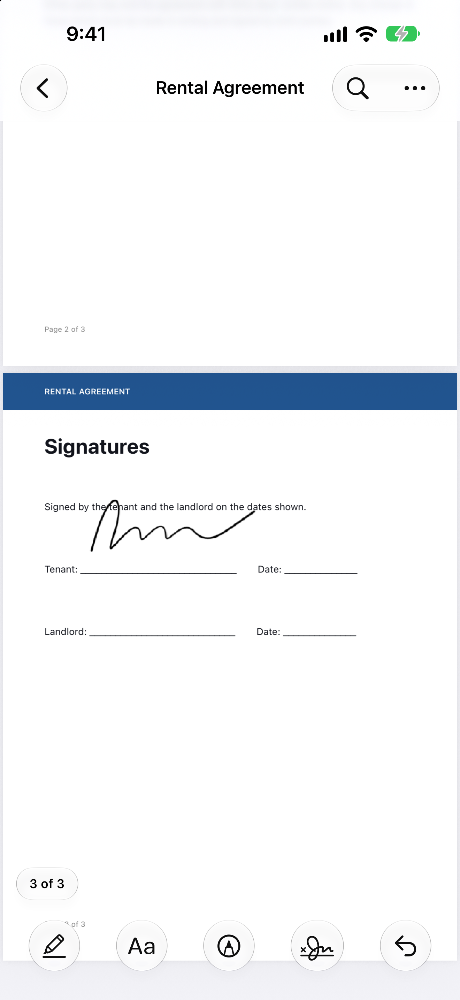
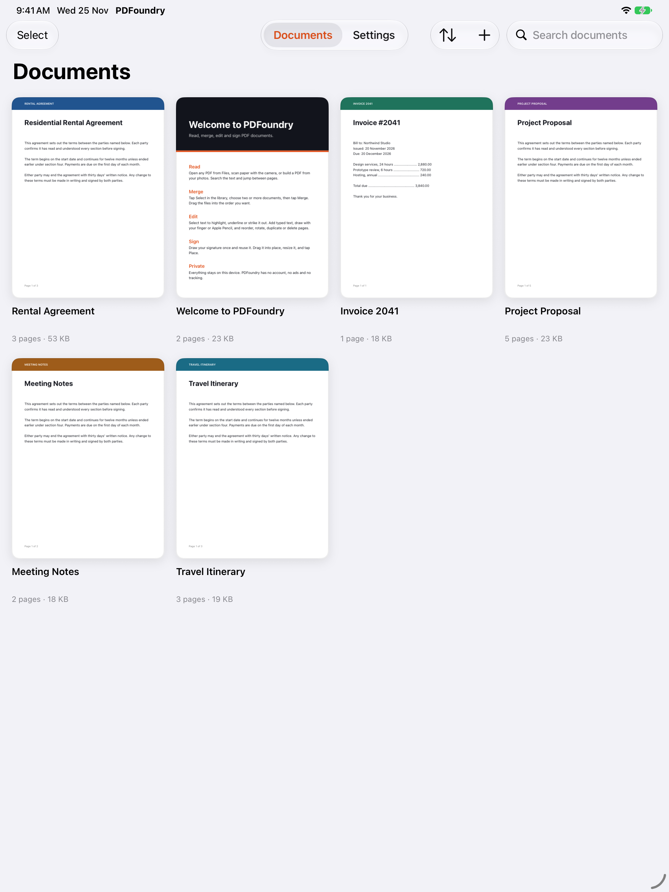
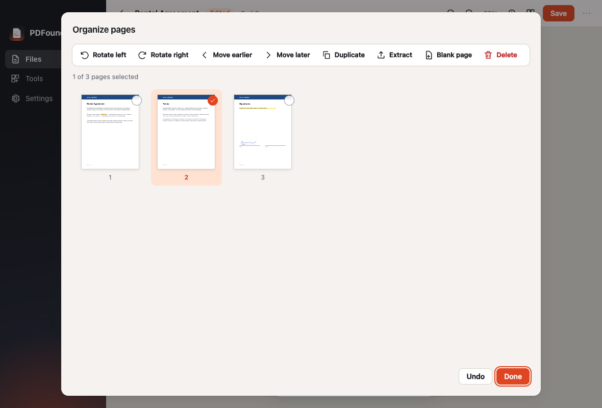
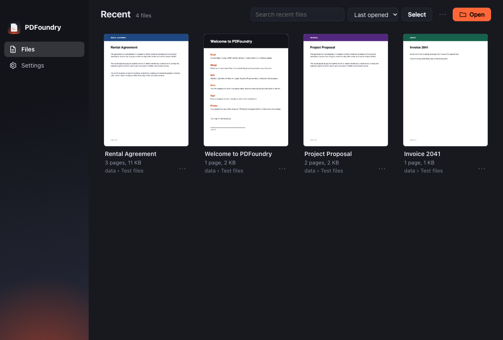

<div align="center">


# PDFoundry

**Read, merge, edit and sign PDFs. Private, on your device, with no account.**

Apps for iPhone, iPad, Android, macOS, Windows and Linux.

[](https://github.com/Fahed-Alhammadi/PDFoundry/actions/workflows/ios.yml)
[](https://github.com/Fahed-Alhammadi/PDFoundry/actions/workflows/android.yml)
[](https://github.com/Fahed-Alhammadi/PDFoundry/actions/workflows/desktop.yml)
[](LICENSE)


[Website](https://fahed-alhammadi.github.io/PDFoundry/) · [Privacy policy](https://fahed-alhammadi.github.io/PDFoundry/privacy.html) · [Report a problem](https://github.com/Fahed-Alhammadi/PDFoundry/issues)

<br>





</div>

## Contents

- [Overview](#overview)
- [Status](#status)
- [Features](#features)
- [Screenshots](#screenshots)
- [Tech stack](#tech-stack)
- [Getting started](#getting-started)
- [Usage](#usage)
- [Tests](#tests)
- [Configuration](#configuration)
- [Releases](#releases)
- [Project structure](#project-structure)
- [Privacy](#privacy)
- [Security](#security)
- [Contributing](#contributing)
- [License](#license)

## Overview

PDFoundry is a small PDF app that does four jobs well: reading, merging, editing and signing. It works entirely on the device. There is no account, no server, no advertising and no analytics. The phone apps make no network requests; the desktop app goes online only to check for its own updates.

The phone apps are native: Swift and SwiftUI on iPhone and iPad, Kotlin and Jetpack Compose on Android. The desktop app is built with Electron and runs on macOS, Windows and Linux. On every platform a PDF opens where you keep it, with no copy made. The desktop app works the way desktop PDF programs do and changes the file only when you choose Save. The phone apps save each change to the same file as you make it, and can put the file back as it was when you opened it.

## Status

| Platform | Version | Status |
|---|---|---|
| iPhone and iPad | 1.0.0 | Submitted to the App Store, waiting for review. Available to testers on TestFlight |
| Android | 1.0.3 | In closed testing on Google Play |
| macOS, Windows and Linux | 1.1.1 | Released. [Download](https://github.com/Fahed-Alhammadi/PDFoundry/releases/latest). The Mac app is signed and notarized |

Store links for the phone apps will be added here and on the [website](https://fahed-alhammadi.github.io/PDFoundry/) when the apps are public.

## Features

| | iPhone and iPad | Android | macOS, Windows and Linux |
|---|---|---|---|
| **Read** | Open a PDF where it is in Files, or receive one from Mail, Safari or the share sheet. Search the text. Scroll vertically or sideways | Open a PDF where it is with the file picker, or receive one from any app's share menu. Search the text. Pinch to zoom | Open a PDF where it is, or drop it onto the window. Search the text. Zoom |
| **Scan and create** | Scan paper with the camera. Build a PDF from photos | Scan paper with Google's document scanner. Build a PDF from photos | Build a PDF from images. No scanning |
| **Merge** | Select documents, drag them into order, merge | Select documents, order them with arrows, merge | Select documents, order them with arrows, merge |
| **Highlight** | Select text, then highlight (four colours), underline or strike through | Drag a marker over the page | Drag a marker over the page, four colours |
| **Text and drawing** | Type anywhere. Draw with a finger or Apple Pencil | Type anywhere (Arabic shapes correctly). Draw with a finger or stylus | Type anywhere (Arabic shapes correctly). Draw with the mouse or a pen |
| **Sign** | Draw once in black or blue ink, reuse, drag and resize before placing | Same | Same |
| **Pages** | Reorder by dragging. Rotate, duplicate, extract, delete, add blank pages | Reorder with arrows. Rotate, duplicate, extract, delete, add blank pages | Reorder by dragging or with arrows. Rotate, duplicate, extract, delete, add blank pages |
| **Undo** | Tap any mark to remove it, or undo recent edits. Revert to Original puts the file back as it was when you opened it | Undo the last ten changes while the document is open. Revert to original puts the file back as it was when you opened it | Undo the last ten changes; nothing is written until you save |
| **Manage** | Rename, duplicate, share, print, delete. A file opened where it is can be removed from the list or copied into the app; the file itself is not touched. A file opened twice is listed once | Same | Save, Save As, print. A list of recent files |
| **Storage** | Files you open stay where you keep them, and changes are saved to the same file. Scans, new PDFs and received files go in the app's folder in Files | Files you open stay where you keep them, and changes are saved to the same file. Scans, new PDFs and received files are kept inside the app | Files stay where you keep them. Changes are written when you choose Save |
| **Protected PDFs** | Open with the password, read-only | Open with the password, read-only | Open with the password, read-only |
| **Permissions** | Camera, asked only when you tap Scan Document | None | None. Goes online only to check for its own updates |

On every platform, signatures and edits are written into the PDF itself, so they look the same in every other PDF reader. Password-protected documents open read-only so their protection is never removed.

## Screenshots

**iPad**

<p>
  
  
  
</p>

**macOS, Windows and Linux**

<p>
  
  
  
  
</p>

**Android**

<p>
  
  
  
  
</p>

## Tech stack

| | iPhone and iPad | Android | macOS, Windows and Linux |
|---|---|---|---|
| Language | Swift 6, strict concurrency, main-actor default isolation | Kotlin | TypeScript |
| UI | SwiftUI with Liquid Glass | Jetpack Compose, Material 3 | Electron, plain HTML and CSS, no framework |
| PDF engine | PDFKit | [PdfBox-Android](https://github.com/TomRoush/PdfBox-Android) for editing, the platform `PdfRenderer` for display | [pdf-lib](https://github.com/cantoo-scribe/pdf-lib) for editing, [PDF.js](https://mozilla.github.io/pdf.js/) for display |
| Drawing | PencilKit | Compose canvas | Canvas |
| Scanning | VisionKit document camera | ML Kit document scanner | None |
| Minimum OS | iOS 26.0 | Android 8.0 (API 26) | A current macOS, Windows 10 or later, a current Linux desktop |
| Project | [XcodeGen](https://github.com/yonaskolb/XcodeGen) (`project.yml`) | Gradle (Kotlin DSL) | npm, esbuild, electron-builder |
| Tests | Swift Testing | Instrumented JUnit tests | Node test runner, plus a self-test in a real window |

The iOS app has no third-party dependencies. The desktop app bundles everything it needs, so its window never uses the network.

## Getting started

```bash
git clone https://github.com/Fahed-Alhammadi/PDFoundry.git
cd PDFoundry
```

### iPhone and iPad

Requires Xcode 27 or later and XcodeGen (`brew install xcodegen`).

```bash
xcodegen generate
open PDFoundry.xcodeproj
```

Select the **PDFoundry** scheme and run. To run on a device, set your own team under *Signing & Capabilities*, or `DEVELOPMENT_TEAM` in `project.yml`.

### Android

Requires JDK 21 and the Android SDK. Open the `android/` folder in Android Studio, or build from the command line:

```bash
cd android
./gradlew :app:assembleDebug
```

The debug build installs next to a Play Store copy, under the ID `io.pdfoundry.app.debug`. See [android/README.md](android/README.md) for release signing.

### macOS, Windows and Linux

Requires Node.js 24 or later.

```bash
cd desktop
npm install
npm start
```

`npm run dist:mac`, `dist:win` or `dist:linux` builds the installers into `desktop/dist/`. See [desktop/README.md](desktop/README.md).

## Usage

| To | iPhone and iPad | Android | macOS, Windows and Linux |
|---|---|---|---|
| Add a document | **+** in the library: Open from Files, Scan Document, or Create from Photos | **+** in the library: Open PDF, Scan document, or Create from photos | **Open**, or drop a PDF on the window. Create from images is in the **…** menu |
| Merge | **Select**, choose documents, tap the merge button | Press and hold to select, choose documents, tap the merge button | **Select**, choose files, **Merge**, then say where to save |
| Highlight | Press and hold text to select it, then tap the highlighter | Tap **Highlight**, then drag over the page | Click **Highlight**, then drag over the page |
| Add text | Tap **Aa**, type, drag the text into place, tap **Place** | Tap **Text**, type, drag the text into place, tap **Place** | Click **Text**, type, drag the text into place, **Place** |
| Draw | Tap the pencil, draw, tap **Done** | Tap **Draw**, draw, tap **Done** | Click **Draw**, draw, **Done** |
| Sign | Tap the signature button, draw or pick a signature, position it, tap **Place** | Tap **Sign**, draw or pick a signature, position it, tap **Place** | Click **Sign**, draw or pick a signature, position it, **Place** |
| Edit pages | **…** then **Organize Pages** | **⋮** then **Organize pages** | The grid button in the toolbar, or **View > Organize Pages** |
| Remove an edit | Tap it, then **Delete** | Tap **Undo** | **Undo** |
| Undo everything since opening | **…** then **Revert to Original** | **⋮** then **Revert to original** | Close without saving |
| Save | Saved automatically, to the same file | Saved automatically, to the same file | **Save** (Ctrl+S or ⌘S), or **Save As** for a new file |

## Tests

```bash
# iOS: unit tests on a simulator
xcodebuild test -project PDFoundry.xcodeproj -scheme PDFoundry \
  -destination 'platform=iOS Simulator,name=iPhone 18 Pro'

# Android: PDF engine and document list tests on a running emulator or device
cd android && ./gradlew :app:connectedDebugAndroidTest

# Desktop: unit tests, then the self-test in a real window
cd desktop && npm test && npm run selftest
```

All three suites run in GitHub Actions on every push. The desktop self-test runs on macOS, Windows and Linux.

## Configuration

The apps need no API keys, servers or environment variables to build and run.

## Releases

| Platform | Trigger | Result |
|---|---|---|
| iOS | Push a tag `ios-X.Y.Z`, or run the **iOS** workflow with "upload" ticked | Signed archive uploaded to TestFlight, internal and external testers |
| Android | Push a tag `android-X.Y.Z`, or run the **Android** workflow with "upload" ticked | Signed bundle uploaded to Google Play closed testing |
| Desktop | Push a tag `desktop-X.Y.Z` | Installers for all three systems on the GitHub release, the Mac app signed and notarized. Installed apps update themselves from it |

Release notes come from `AppStore/whatsnew/en-US.txt` and `android/whatsnew/whatsnew-en-US`. Promotion to the public stores is done by hand. Desktop release notes are the commits that touched `desktop/`.

## Project structure

```
PDFoundry/
├── project.yml                 # XcodeGen project definition (iOS)
├── PDFoundry/                  # iOS app
│   ├── App/                    # Entry point and tab layout
│   ├── Core/                   # Library store, PDF operations, signature store, brand
│   ├── Features/
│   │   ├── Library/            # Document grid, import, scan, merge
│   │   ├── Reader/             # PDF view, markup, drawing, placement
│   │   ├── Pages/              # Page organizer
│   │   ├── Sign/               # Signature pad and saved signatures
│   │   └── Settings/           # Settings and About
│   └── Resources/              # Asset catalog, privacy manifest
├── PDFoundryTests/             # iOS unit tests
├── android/                    # Android app
│   ├── app/src/main/           # Kotlin sources: data/ (PDF engine, library), ui/ (screens)
│   ├── app/src/androidTest/    # PDF engine tests
│   ├── play/                   # Google Play listing text and store images
│   └── whatsnew/               # Google Play release notes
├── desktop/                    # Desktop app (Electron)
│   ├── src/core/               # PDF engine, shared by the window and the tests
│   ├── src/main/               # Main process: file access, updates, window
│   ├── src/ui/                 # The window: recent files, reader, organizer, settings
│   └── test/                   # Unit tests
├── AppStore/                   # App Store listing text, store images, release notes
├── Tools/                      # Scripts that render the icons and store images
├── scripts/                    # CI helpers: TestFlight, desktop release and update signing
├── Website/                    # Project website (GitHub Pages)
├── screenshots/                # Screenshots by platform
└── .github/workflows/          # iOS, Android, desktop and website workflows
```

## Privacy

PDFoundry collects nothing. Documents and signatures stay on the device, and the apps contain no analytics or advertising. The Android build removes the network permission altogether, so it cannot reach the internet. The desktop app's window is blocked from the network too; the only connection it makes is to GitHub, to check for and download its own updates. Read the [privacy policy](https://fahed-alhammadi.github.io/PDFoundry/privacy.html).

## Security

Found a vulnerability? Please report it privately, as described in the [security policy](SECURITY.md), not in a public issue.

## Contributing

Issues and pull requests are welcome.

1. Open an issue first for anything larger than a small fix, so the approach can be agreed.
2. Keep each pull request focused on one change.
3. Run the tests for the platform you touched before opening it.

## License

Released under the [MIT License](LICENSE).

© 2026 Fahed Alhammadi. All rights reserved.
